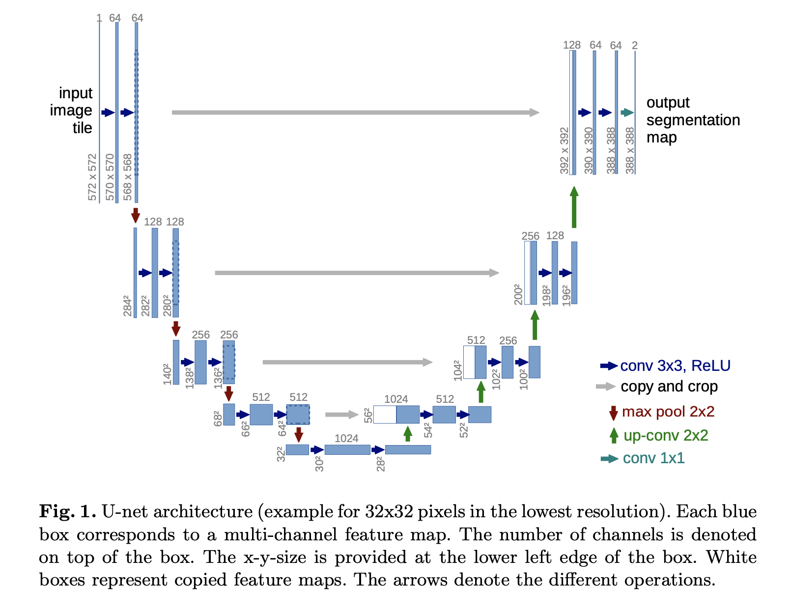

# Binary Image Segmentation with U-Net (PyTorch)

A PyTorch project for binary image segmentation. It includes two U-Net
implementations, image/mask pair loading and preprocessing, training and
evaluation scripts, post-training quantization experiments, ONNX/TensorRT
inference tools, and utilities for analyzing the ISIC dataset.



## Architectures

The `models/` directory contains two models:

- **Classic U-Net** (`models/unet_classic.py`, `UNetClassic`): the original
  five-level architecture, with valid convolutions (no padding) and
  center-cropped skip connections. As a result, its spatial output is smaller
  than its input.
- **Modern U-Net** (`models/unet_modern.py`, `UNetModern`): uses padded
  convolutions, four encoder levels, and a bottleneck. It preserves the input
  height and width and allows the base channel count and BatchNorm to be
  configured.

Both models return logits for a binary mask. `train.py` uses the modern U-Net
with 64 base channels and BatchNorm by default. Choose either architecture with
`--model modern` or `--model classic`; `--base-channels` configures the channel
count of either model.

## Project structure

```text
.
├── data/
│   ├── data_loading.py       # Image and mask loading and normalization
│   ├── splits.py             # Reproducible split generation and loading
│   └── transforms.py         # Synchronized image/mask transforms
├── datasets/                 # Locally extracted data (not tracked by Git)
│   ├── data_Carvana/
│   │   ├── imgs/
│   │   └── masks/
│   ├── data_ISBI/
│   │   ├── imgs/
│   │   └── masks/
│   ├── data_ISIC/
│   │   ├── imgs/
│   │   └── masks/
│   └── subset_ISIC/          # Optional local dataset subset
├── models/
│   ├── unet_classic.py
│   └── unet_modern.py
├── quantization/
│   ├── bn_fold.py
│   ├── calibrate.py
│   ├── env_report.py
│   ├── export_onnx.py
│   ├── formats.py
│   ├── int8.py
│   ├── modes.py
│   ├── qdq_onnx.py
│   ├── quantize_model.py
│   └── trt_engine.py
├── tests/                    # Unit tests (python -m unittest discover -s tests -t .)
│   └── test_*.py
├── graphs/
│   └── unet_architecture.png # Retained architecture diagram
├── profiling/
│   └── performance_logger.py
├── splits/                   # Saved splits for each dataset
│   ├── Carvana/
│   ├── ISBI/
│   └── ISIC/
├── utilis/
│   ├── checkpoint.py
│   ├── evaluation.py
│   ├── fp16_scaler.py
│   ├── loss.py
│   └── metrics.py
├── checkpoints/              # Generated checkpoints, TensorBoard logs, and CSVs
├── calibration/              # Generated activation-calibration JSON files
├── exports/                  # Generated ONNX files and TensorRT engine cache
├── test_results/             # Evaluation summary and per-sample CSVs
├── datasets.zip              # Dataset archive (requires Git LFS for GitHub)
├── .gitignore
├── README.md
├── eval.py
├── inference.py
├── test.py
└── train.py
```

`data/`, `datasets/`, `splits/`, `models/`, `quantization/`, `tests/`,
`profiling/`, and `utilis/` are separate directories. `calibration/`, `exports/`, and
`test_results/` contain generated artifacts. Git ignores the extracted
`datasets/` directory and `checkpoints/`, but does not ignore `datasets.zip`.
The current archive is about 1.2 GB, so uploading it to GitHub requires Git LFS
or an external file hosting service: GitHub rejects files larger than 100 MB
in regular Git repositories.

## Preparing the data

Extract `datasets.zip` into the project root and check that the directories
have the following structure:

```text
datasets/
├── data_Carvana/
│   ├── imgs/
│   └── masks/
├── data_ISBI/
│   ├── imgs/
│   └── masks/
└── data_ISIC/
    ├── imgs/
    └── masks/
```

Each image must have a corresponding mask with the same base filename (for
example, `sample_01.jpg` and `sample_01.png`), and both files must have the
same dimensions. ISBI is loaded as a single-channel image; Carvana and ISIC
are loaded as three-channel RGB images. Images are converted to values between
0 and 1, and masks are converted to binary values.

## Installation

Install PyTorch and the dependencies used by the scripts:

```bash
pip install torch torchvision numpy Pillow tqdm tensorboard matplotlib scikit-learn prefetch-generator
```

Training uses CUDA when available and otherwise runs on the CPU.

ONNX export and Q/DQ graph generation also require the ONNX packages supported
by the installed PyTorch ONNX exporter:

```bash
pip install onnx onnxscript
```

TensorRT inference is optional. Install a TensorRT Python package compatible
with the system's NVIDIA GPU, CUDA, and PyTorch environment using NVIDIA's
installation instructions; there is no portable TensorRT install command for
all platforms. The PyTorch evaluation backend does not require TensorRT.
`nvidia-ml-py` is optional and enables NVIDIA driver-version reporting:

```bash
pip install nvidia-ml-py
```

The project does not pin package versions in a dependency file. Record the
environment used for an experiment with:

```bash
python -m quantization.env_report
```

## Training

Run commands from the repository root. For example:

```bash
python train.py --dataset ISBI --precision FP16 --epochs 50
python train.py --dataset Carvana --precision FP32 --epochs 10
python train.py --dataset ISIC --precision BF16 --epochs 10
python train.py --dataset ISIC --model modern --base-channels 32
python train.py --dataset ISIC --model classic --base-channels 32
```

Training applies paired transforms to images and masks: random crops, elastic
deformation, and horizontal and vertical flips. Validation does not apply
these transforms and uses a batch size of one.

By default, training uses a reproducible random split with seed 42 and 10%
validation data. You can select one of the saved splits, from 0 to 4:

```bash
python train.py --dataset ISIC --split 0 --precision FP32 --epochs 10
```

Saved splits are stored in `splits/<dataset>/train_N.txt` and
`valid_N.txt`. To regenerate them (five independent splits, reproducible by
seed and with 10% validation data):

```bash
python data/splits.py --dataset ISIC --folds 5 --validation 10 --seed 42
```

### Main arguments

| Argument | Default | Description |
|---|---:|---|
| `--dataset` | Required | `Carvana`, `ISBI`, or `ISIC` |
| `--model` | `modern` | `modern` or `classic` |
| `--base-channels` | `64` | Base channel count for the selected U-Net |
| `--precision` | `FP32` | `FP32`, `FP16`, or `BF16` (AMP) |
| `--cast` | None | `FP16` or `BF16`: whole model in 16 bits (experimental) |
| `--tf32` | `off` | `on` allows TF32 in FP32 convolutions and matmuls (PyTorch's own default turns it on for convolutions) |
| `--epochs` | `10` | Number of epochs |
| `--batch-size` | `5` | Training batch size |
| `--num-workers` | `min(4, CPU count)` | DataLoader worker processes |
| `--crop` | `512` | Training crop size; accepts `N` or `H W` |
| `--validation` | `10` | Validation percentage for the random split |
| `--split` | Random | Saved split, from `0` to `4` |
| `--seed` | `42` | Random seed |
| `--lr` | `0.0001` | Learning rate |
| `--output` | `checkpoints` | Output directory |
| `--experiment-name` | No CSV | Optional name for the per-epoch CSV (`--experiment_name` is also accepted) |

Example using a rectangular crop:

```bash
python train.py --dataset ISBI --precision FP16 --epochs 50 --crop 256 384
```

FP16 and BF16 use automatic mixed precision (AMP) when training on CUDA.
FP16 also uses gradient scaling. `--cast BF16` or `--cast FP16` instead trains the whole
model (weights, gradients, Adam state) in 16 bits, without FP32 master weights;
`--cast FP16` adds dynamic loss scaling (`utilis/fp16_scaler.py`). Both are
experimental: a one-epoch BF16 test trained normally, but the FP16 test
diverged (NaN loss), which is still under investigation. On CPU, training runs without AMP. The loss
combines binary cross-entropy and soft Dice. The Dice score is calculated on
the binary segmentation. When `--experiment-name` is set, the per-epoch CSV
includes the training BCE and Dice losses, their weighted contributions to
the total loss, the corresponding validation loss components, and the training
and validation Dice scores. It also records the model name and parameter count,
validation forward latency and throughput, model weight size, and peak GPU
memory use per epoch.

## Results and monitoring

- The best checkpoint is saved to
  `<output>/best_unet_<dataset>_new.pth` by default, based on the lowest
  validation loss (`checkpoints/` is the default output directory). With
  `--experiment-name NAME`, it is saved as `<output>/best_NAME.pth`. It
  includes the model weights, optimizer state, epoch, configuration, and
  losses.
- TensorBoard logs and example images, ground-truth masks, and predictions
  are saved under `checkpoints/tensorboard/<dataset>/`.
- Enable a per-epoch summary CSV with `--experiment_name`. It is saved to
  `checkpoints/performance/<name>.csv` and includes training and validation
  loss and Dice, model name and parameter count, epoch duration, training
  throughput, validation forward latency and throughput, model weight size,
  and peak GPU memory. Validation latency excludes up to three warm-up batches.
  This CSV is not generated if the argument is omitted.
- `PerformanceLogger` also measures timing and memory usage during training.
- When training finishes, `train.py` displays the loss and Dice curves for
  that run.

To launch TensorBoard:

```bash
tensorboard --logdir checkpoints/tensorboard
```

## Evaluating a checkpoint

`test.py` evaluates a checkpoint using either PyTorch or TensorRT. For
example, the default PyTorch backend evaluates a saved validation split:

```bash
python test.py --dataset ISBI --checkpoint checkpoints/best_unet_ISBI_new.pth --model modern --split 0
```

Use `--split full` to evaluate `datasets/test_<dataset>/`; without `--split`,
the script recreates the checkpoint's training split and evaluates its
validation portion. The split seed and validation percentage default to the
values saved in the checkpoint (or 42 and 10%, respectively, if unavailable).
For a classic U-Net checkpoint, use `--model classic`; pass the matching
`--base-channels` if it differs from 64.

The default `--backend pytorch` supports FP32, FP16/BF16 autocast on CUDA,
whole-model `--cast FP16` or `--cast BF16`, and optional `--tf32 on`. The
`--fold-bn` flag folds BatchNorm for a floating-point evaluation. `--precision`
and `--cast` are separate experiments and cannot be combined. Results are
written under `test_results/` by default; use `--output` to choose another
directory.

`summary.csv` appends one row per run. Per-image loss components and Dice are
written to `per_sample/`; the file name includes the checkpoint, dataset,
split, model, precision, backend, and quantization settings. A repeated run
with the same name overwrites that per-sample file but still appends another
summary row. The summary distinguishes numerical representation, storage,
and execution backend, and includes available GPU, driver, PyTorch, and
TensorRT information. On TensorRT runs, engine size and inspected layer
precision are also recorded.

`inference.py` contains prediction and evaluation utilities, including an
option to average predictions from flipped inputs (test-time augmentation).

## Quantization

The goal is to measure how much numerical precision the U-Net can lose
while keeping its segmentation quality. Every experiment states three
properties separately, because they are not the same thing:

| Property | Question it answers |
|---|---|
| **Representation** | Which values are the numbers restricted to (e.g. the INT4 grid)? |
| **Storage** | How are the weights actually held in memory? |
| **Execution** | Which kernels actually computed the convolutions? |

`summary.csv` has one column for each (`representation`, `storage`,
`execution`), filled from the run itself (for TensorRT, from the built engine).

### Two evaluation paths

| | `--backend pytorch` (simulation) | `--backend tensorrt` (real) |
|---|---|---|
| What happens | Values are rounded onto the format's grid ("fake quantization") but stored and computed in FP32 | A TensorRT engine stores the weights in the format and, where kernels exist, computes in it |
| Use it for | **Accuracy** of any format, with no hardware restrictions | **Storage, latency and memory** of what the GPU can really run |
| Formats | All | INT8 and FP8 (weights + activations); INT4 and FP4 (weight storage only) |

PyTorch has no INT8/FP8/FP4 convolution kernels on CUDA, so the real path
goes through ONNX: the FP32 model is exported to an ONNX graph,
QuantizeLinear/DequantizeLinear (Q/DQ) nodes mark which tensors use which
format and scale, and TensorRT fuses them into low-precision kernels.

```text
checkpoint ──export_onnx.py──▶ FP32 ONNX ──qdq_onnx.py──▶ Q/DQ ONNX ──trt_engine.py──▶ engine
                                     (qdq_onnx.py and trt_engine.py are called by test.py --backend tensorrt)
```

### Formats (`--quant`)

All formats use symmetric scale quantization, `x_hat = round_to_format(x * s) / s`
with `s = qmax / amax`; only the grid changes.

| `--quant` | Grid | qmax | Simulation | TensorRT (RTX 5080, TensorRT 11.4) |
|---|---|---:|---|---|
| `INT8` | Integers in [-127, 127] | 127 | ✅ | ✅ W8A8: INT8 kernels, INT32 accumulation |
| `FP8` | E4M3 minifloat | 448 | ✅ | ✅ W8A8: E4M3 kernels, FP32 accumulation |
| `INT4` | Integers in [-7, 7] | 7 | ✅ | Weight-only: 4-bit weights stored in the engine, FP32 convolutions |
| `FP4` | E2M1: ±{0, 0.5, 1, 1.5, 2, 3, 4, 6} | 6 | ✅ | Weight-only, same as INT4 |
| `FP6` | E2M3 minifloat | 7.5 | ✅ | ❌ (no FP6 type in TensorRT) |
| `NVFP4` | FP4, blocks of 16, E4M3 block scales | 6 | ✅ | ❌ |
| `MXFP4` | FP4, blocks of 32, power-of-two (E8M0) block scales | 6 | ✅ | ❌ |

Not available in TensorRT for convolutions: 4-bit activations, block scales,
different formats for activations and weights, and FP6. `test.py` stops with
an explanation instead of silently falling back to FP32. Weight-only INT8/FP8
engines are built, but TensorRT folds those weights back to FP32 (the
`storage` column says so).

FP16/BF16 (`--cast`, `--precision`) are not quantization: they are native
PyTorch types with their own kernels, no scales and no calibration.

### Options

| Option | Meaning |
|---|---|
| `--quant MODE` | Weight format (and default activation format), see the table above |
| `--block-size N` | Weights: one scale per N input channels instead of per output channel (NVFP4: 16, MXFP4: 32 by default) |
| `--scale-format {fp32,e4m3,e8m0}` | Storage of the block scales (default `fp32`; set by the NVFP4/MXFP4 presets) |
| `--act-calib METHOD --calib-file JSON` | Also quantize the input of every layer, per tensor, with a calibrated range |
| `--act-dynamic` | Quantize activations per block of input channels, range computed on the fly (no calibration) |
| `--act-format FMT` | Activation format different from the weights (e.g. `--quant INT4 --act-format INT8` = W4A8) |
| `--fp-layers a,b` | Layers kept in FP32, weights and input (e.g. `enc1.block.0`) |
| `--backend {pytorch,tensorrt}` | Simulation or real engine |
| `--upsample {convtranspose,depth2space}` | TensorRT graph for the upsamplers (FP8 uses `depth2space` automatically) |

Without `--act-calib`/`--act-dynamic` only the weights are quantized and the
activations stay in FP32 (W8A32, W4A32, ...). BatchNorm is always folded
into the convolutions first (`quantization/bn_fold.py`).

### Recommended workflow

Run every command from the repository root. Use the validation split for
all comparisons; evaluate the held-out test set (`--split full`) only once,
for the final results.

**1. Train** in FP32 (or with AMP, `--precision BF16`). `--cast BF16`/`--cast FP16`
train the whole model in 16 bits without FP32 master weights, as a separate
experiment.

```bash
python train.py --dataset Carvana --epochs 10 --batch-size 5 --experiment-name CarvanaBaseline
```

**2. FP32 baseline** on the validation split (the reference for every
comparison; TF32 is off by default):

```bash
python test.py --dataset Carvana --checkpoint checkpoints/best_CarvanaBaseline.pth
```

**3. Calibrate** the activation ranges. The script runs the BN-folded FP32
model, without quantizing anything, on 128 training images and saves one
range (`amax`) per layer for every method. Both the simulation and TensorRT
read this file. Weights need no calibration: their range comes from the
weights themselves.

```bash
python -m quantization.calibrate --dataset Carvana --checkpoint checkpoints/best_CarvanaBaseline.pth --samples 128
```

Methods: `max`, `percentile-99.9`, `percentile-99.99`, `percentile-99.999`,
`entropy` and `entropy-skip-zeros` (our variant that ignores the exact zeros
produced by ReLU; plain `entropy` clips too much on this U-Net).

**4. Simulate** the formats to measure accuracy (fast, any format):

```bash
python test.py --dataset Carvana --checkpoint checkpoints/best_CarvanaBaseline.pth --quant INT8 --act-calib percentile-99.99 --calib-file calibration/best_CarvanaBaseline_n128.json
python test.py --dataset Carvana --checkpoint checkpoints/best_CarvanaBaseline.pth --quant INT4 --fp-layers enc1.block.0
python test.py --dataset Carvana --checkpoint checkpoints/best_CarvanaBaseline.pth --quant INT4 --block-size 32
python test.py --dataset Carvana --checkpoint checkpoints/best_CarvanaBaseline.pth --quant NVFP4 --fp-layers enc1.block.0
```

**5. Export to ONNX** once per checkpoint (twice for FP8):

```bash
python -m quantization.export_onnx --dataset Carvana --checkpoint checkpoints/best_CarvanaBaseline.pth
python -m quantization.export_onnx --dataset Carvana --checkpoint checkpoints/best_CarvanaBaseline.pth --upsample depth2space
```

**6. Run the real engines** with TensorRT (FP32 first, as the TensorRT reference):

```bash
python test.py --dataset Carvana --checkpoint checkpoints/best_CarvanaBaseline.pth --backend tensorrt
python test.py --dataset Carvana --checkpoint checkpoints/best_CarvanaBaseline.pth --backend tensorrt --quant INT8 --act-calib percentile-99.99 --calib-file calibration/best_CarvanaBaseline_n128.json
python test.py --dataset Carvana --checkpoint checkpoints/best_CarvanaBaseline.pth --backend tensorrt --quant FP8 --act-calib percentile-99.99 --calib-file calibration/best_CarvanaBaseline_n128.json --fp-layers enc1.block.0
python test.py --dataset Carvana --checkpoint checkpoints/best_CarvanaBaseline.pth --backend tensorrt --quant INT4 --fp-layers enc1.block.0
```

Compare TensorRT quantized runs with the TensorRT FP32 run, not with PyTorch
FP32: TensorRT FP32 alone is about twice as fast as PyTorch, so a comparison
against PyTorch mixes the effect of the engine with the effect of quantization.

### Practical notes

- **Keep the first convolution in FP32** (`--fp-layers enc1.block.0`) for FP8
  and every 4-bit format. Its 27-weight filters sum to almost zero, so on
  uniform image regions their rounding errors add up instead of cancelling.
  It is 1,728 of 31 M weights. Carvana validation, weights only (FP32 = 0.9907):

  | Weights | All layers quantized | `enc1.block.0` in FP32 |
  |---|---:|---:|
  | INT4 per channel | 0.4572 | 0.9909 |
  | INT4, blocks of 32 | 0.9632 | 0.9910 |
  | FP4 per channel | 0.9323 | 0.9891 |
  | NVFP4 | 0.8222 | 0.9903 |
  | MXFP4 | 0.3531 | 0.9848 |
  | FP6 per channel | 0.9781 | 0.9907 |
  | FP8 per channel | 0.9719 | 0.9908 |
- **Engines are specific** to the GPU model and TensorRT version: build them
  on each machine (they are cached under `exports/engines/`). The L40/L40S has
  FP8 and INT8 but no FP4/FP6 hardware.
- **Memory:** simulating FP8/FP6/FP4 *activations* creates temporaries the
  size of each activation and does not fit full-resolution Carvana on a 16 GB
  GPU. Weight-only simulation and INT8/INT4 activation simulation (in place)
  use the same memory as FP32. ISIC's largest images (up to 2848×4288) need
  more memory than the RTX 5080 has in FP32.
- **Variable sizes:** the engine profile covers the sizes of the evaluated
  images. Carvana has one size; ISIC has 74, which has not been tested yet.
- The low-level scripts can be run on their own: `quantization/qdq_onnx.py`
  writes a Q/DQ ONNX (`--format int8|fp8|int4|fp4`), and
  `quantization/env_report.py` prints the software/hardware versions.

### Code map

| File | Responsibility |
|---|---|
| `quantization/modes.py` | Command-line options → what to quantize and how; what each backend can do |
| `quantization/formats.py` | Number formats (INT8/INT4/FP8/FP6/FP4) and granularities (tensor/channel/block) for the simulation |
| `quantization/int8.py` | INT8 arithmetic (scale, quantize, dequantize, in-place fake quantization) |
| `quantization/bn_fold.py` | Folds BatchNorm into the preceding convolution |
| `quantization/quantize_model.py` | Applies the simulation to the model (weights once, activations through hooks) |
| `quantization/calibrate.py` | Activation ranges from training images |
| `quantization/export_onnx.py` | FP32 ONNX with dynamic H, W (exact rewrites of the ConvTranspose upsamplers) |
| `quantization/qdq_onnx.py` | FP32 ONNX → ONNX with low-precision weights and Q/DQ nodes |
| `quantization/trt_engine.py` | Builds, caches, inspects and runs TensorRT engines |
| `quantization/env_report.py` | GPU, driver, CUDA, PyTorch and TensorRT versions |
| `utilis/evaluation.py` | test.py helpers, including the representation/storage/execution description |

### Tests

The unit tests check the arithmetic against independent references (e.g.
the FP4/FP6/FP8 grids against `ml_dtypes`), that the ONNX rewrites are exact,
and that the engines really use the expected kernels. They are not needed to
train or evaluate. Run them all from the repository root (TensorRT tests are
skipped without a CUDA GPU and TensorRT):

```bash
python -m unittest discover -s tests -t .
```

Or a single file, e.g. `python -m unittest tests.test_formats -v`.
